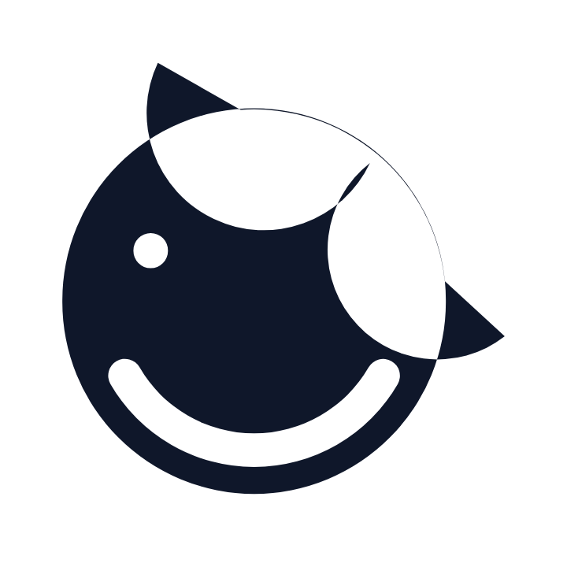
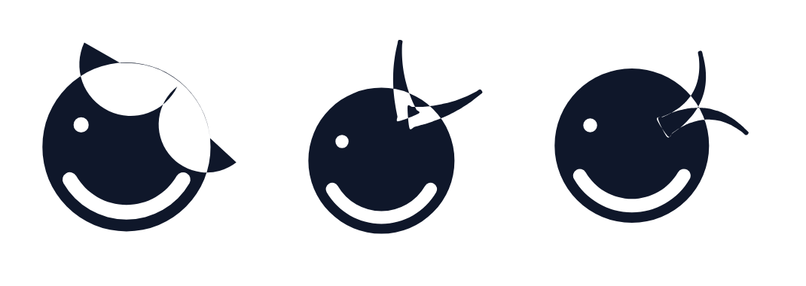
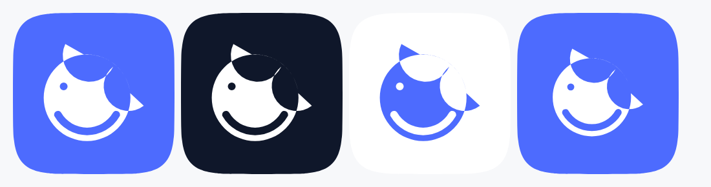
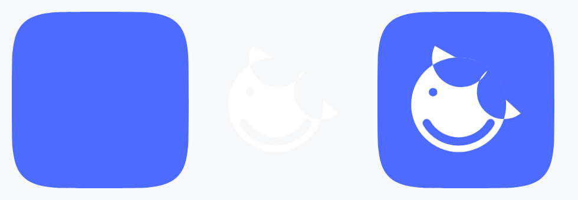

# dsh-mobile-next · Logo & App Icon

品牌标识系统。鲸鱼主体保留 DeepSeek 的识别点（圆润鲸身 / 白色腹部 / 上扬尾鳍 / 近圆形轮廓），用几何重绘并叠加 mobile 与 next 的意象。



| 资产 | 文件 |
| --- | --- |
| 主标识（单路径，ink） | [dsh-mobile-next-mark.svg](dsh-mobile-next-mark.svg) |
| 主标识 蓝色 / 墨蓝 / 反白 | [blue](dsh-mobile-next-mark-blue.svg) · [ink](dsh-mobile-next-mark-ink.svg) · [reverse](dsh-mobile-next-mark-reverse.svg) |
| 三个概念方向 | [A](concept-a-chevron.svg) · [B](concept-b-twin.svg) · [C](concept-c-orbit.svg) |
| App icon（蓝底 / 暗底 / 亮底 / maskable / 方形） | [app-icon.svg](app-icon.svg) · [dark](app-icon-dark.svg) · [light](app-icon-light.svg) · [maskable](app-icon-maskable.svg) · [square](app-icon-square.svg) |
| 前景 / 背景分层 | [layers/](layers/) |
| 构造图 | [construction.svg](construction.svg) |
| 栅格导出 | [png/](png/) |

---

## 1 设计理念与视觉语言

### 1.1 一句话

**一只正在上浮的鲸，它的尾鳍就是一枚朝上的箭头。**

### 1.2 三个必须被读出来的信息

| 层 | 视觉载体 | 读法 |
| --- | --- | --- |
| 鲸 | 近圆形鲸身 + 白色腹部槽 + 眼点 | 继承 DeepSeek 官方鲸鱼的辨识度 |
| mobile | 整体收在 1:1 圆角画布里，腹部槽是一根**圆角胶囊**（home indicator 的形） | 一眼"这是手机上的东西" |
| next | 尾鳍双叶构成向上的 V，轴线从鲸身指向右上（约 1–2 点方向） | 前进 / 上浮 / 下一代 |

三者在**同一个轮廓**里完成：没有额外加箭头、加播放键、加手机外框。意象来自形状本身的朝向，而不是贴图标——这是小尺寸能活下来的前提。

### 1.3 视觉语言规则

1. **近圆形轮廓**。鲸身是正圆（不是椭圆），尾鳍外扩后整体墨迹包围盒约 1.03 : 1，视觉上仍是"一个圆"。这让它和 DeepSeek 原标志的圆形体量对齐，也让它在圆形头像框里不空、不挤。
2. **单一墨迹**。整个标识是**一条 path、四个子路径**（鲸身 / 尾鳍 / 腹部槽 / 眼点），`fill-rule="evenodd"`。腹部与眼睛是**真挖空**（transparent），不是白色填充——换到深色底、渐变底、图片底都不会出现"白补丁"。
3. **两个圆角半径**。外形轮廓上的凸角半径 = `0.09R`（尾尖）与 `0.15R`（尾鳍 V 形凹口）；腹部槽两端是半圆帽。没有第三个半径，圆角语言统一。
4. **零描边、零渐变、零阴影**。全部实心填充。这和 `docs/10-ui-spec.md` 的 house rule（flat、无 glow、无 glass）一致。
5. **不描边也能读**。所有关键间隙 ≥ `0.17R`，缩到 16 px 时尾鳍凹口与腹部槽仍各占 ≥ 1 px。

### 1.4 造型逻辑（为什么是这个形状）

```
         ╱╲            ← 尾鳍：双叶 + V 形凹口，轴线 -50°
        ╱  ╲              两叶根部落在鲸身圆周上，与身体共用同一条弧
   ┌──────────┐
   │   ●      │        ← 眼点：位于 206° 方向、0.60R 处（略偏左下的"视线向前"）
   │          │
   ╰──▬▬▬───╯         ← 腹部槽：150°→30° 的圆角胶囊，沿身体下缘内缩 0.135R
```

- **尾鳍**：不是贴在圆上的三角形，而是**从圆周上切出的两片扇形叶**，根部落在 `-94°` 与 `-6°` 两个锚点，尖端在 `1.34R / -112°` 与 `1.32R / +8°`。两叶之间的凹口（`0.94R`、`-50°`）是 V 形的底。这样尾鳍和身体之间没有"接缝"，是一条连续轮廓。
- **腹部槽**：官方鲸鱼是白色肚皮块面；这里把它压缩成**一根沿下缘的胶囊**。既保留"白肚子"的记忆点，又借用手机 home indicator 的形，是 mobile 意象最省笔画的一次植入。
- **眼点**：一个纯圆。位置偏左下（`206°`），让鲸"朝右上看"——与尾鳍的上扬方向形成一条对角线，静态图形里有方向感。

---

## 2 三个概念方向



### A · Chevron（推荐）

- **造型逻辑**：尾鳍 = 两片宽基扇形叶，根部与鲸身共用同一段圆弧，叶间一个浅 V 凹口；凹口底落在 `0.94R`，比圆周略内收，读起来是"尾鳍"而不是"箭头"。
- **next 在哪**：双叶的**外缘延长线**在身体上方交汇，形成一条隐形的向上箭头轴线；V 形凹口是箭头的负形。
- **mobile 在哪**：腹部胶囊槽。
- **优点**：单叶面积大、间隙宽，16 px 仍可辨认；轮廓最接近圆形，最适合圆形头像 / 圆形启动图。
- **代价**：方向感最"温和"，next 需要配合 wordmark 或动效才能被强烈读出。
- **文件**：[concept-a-chevron.svg](concept-a-chevron.svg)

### B · Twin（双叶分离）

- **造型逻辑**：两片**独立**的锥形叶从鲸身内部长出（根部沉入 `0.30R`），叶身带外弓（bow `±0.14`），叶尖朝 `-58°±38°`。两叶之间是**通透的 V 形空白**，一直开到身体边缘。
- **next 在哪**：双叶 = 两次"chevron"，即 next 的 next；也像两级推进的喷口。镂空 V 是最强的方向信号。
- **mobile 在哪**：腹部胶囊槽 + 整体圆形体量。
- **优点**：方向感最强，动效延展最好（两叶可分别做 stagger 上浮）。
- **代价**：两叶细，`≤24 px` 时 V 形空隙开始糊；墨迹包围盒偏高（1 : 1.11），在圆形头像里偏瘦。
- **文件**：[concept-b-twin.svg](concept-b-twin.svg)

### C · Orbit（环游）

- **造型逻辑**：两片叶**向下前方**弯（bow `-0.40`），根部沉到 `0.54R`，叶尖越过身体右侧轮廓，形成一条"绕行"的弧线，读作鲸尾在摆动、也读作一个环形箭头。
- **next 在哪**：环形运动 = 持续前进；叶片越出圆形边界，打破"静态徽章"的封闭感。
- **mobile 在哪**：腹部胶囊槽。
- **优点**：最有动势，适合作为加载态 / 启动动画的母版。
- **代价**：越界叶片让墨迹包围盒变宽（1.13 : 1），在方形/圆形 mask 里会偏挤；小尺寸下越界部分最先丢失，退化后只剩"圆 + 一撮"，识别度最不稳。
- **文件**：[concept-c-orbit.svg](concept-c-orbit.svg)

### 选型结论

**A 为主标识，B 作为动效 / 大尺寸场景的备选，C 仅用于动效母版。**
判据：A 在 16 / 24 / 32 px 三档的辨识度最好（见 [preview/size-ladder.png](preview/size-ladder.png)），且轮廓圆度最贴合 DeepSeek 原标志的体量；B、C 的差异化收益集中在 ≥ 64 px，属于"锦上添花"层。

---

## 3 推荐方案：几何参数与配色

### 3.1 构造网格


画布 `1024 × 1024`，8 × 8 模块网格（每格 128）。所有坐标都是**烘焙后的绝对值**，文件里没有任何 `transform`——导入 Figma / Sketch / 转字体时不会错位。

| 元素 | 参数 |
| --- | --- |
| 鲸身 | 正圆，圆心 `(458.91, 543.77)`，`R = 346.29`（占画布 33.8%） |
| 尾鳍根部锚点 | 圆周上 `-94°` 与 `-6°`（尾鳍占 88° 圆周） |
| 尾鳍轴线 | `-50°`（指向右上） |
| 左叶尖 | `1.34R` @ `-112°` → `(285.1, 113.5)` |
| 右叶尖 | `1.32R` @ `+8°` → `(911.6, 607.4)` |
| V 形凹口底 | `0.94R` @ `-50°` → `(668.1, 294.4)` |
| 尾尖圆角 | `0.09R = 31.17` |
| 凹口圆角 | `0.15R = 51.94` |
| 腹部槽 | 外径 `0.865R = 299.54`，内径 `0.69R = 238.94`，粗 `0.175R = 60.6`，弧 `150°→30°`，两端半圆帽 `30.3` |
| 眼点 | 圆心 `0.60R` @ `206°` → `(272.2, 452.7)`，`r = 0.09R = 31.17` |
| 墨迹包围盒 | `800 × 779`（78.1% × 76.1% 画布），视觉重心在 `(512, 512)` 偏上 10 |

### 3.2 SVG 路径数据思路

单条 `d`，四个子路径，`fill-rule="evenodd"`：

```
M … 鲸身（两段 A 弧组成的整圆，从 9 点位置起笔）
M … 尾鳍（L 到左叶尖 → A 圆角 → A 到凹口 → A 圆角 → A 到右叶尖 → L 回右根 → A 沿圆周回到左根 → Z）
M … 腹部槽（A 外弧 150°→30° → A 半圆帽 → A 内弧回程 → A 半圆帽 → Z）
M … 眼点（两段 A 弧组成的整圆）
```

要点：

1. **尾鳍用"沿圆周回程"闭合**：最后一段 `A 346.29 346.29 0 large 0 <左根>` 走的是鲸身自己的弧，且 `sweep=0`（逆时针、短弧，`large-arc-flag` 由 `(|a2-a1| mod 360) > 180` 决定）。这样尾鳍与鲸身**共边**，两者叠加时不会出现描边缝或透明度叠色。
2. **挖空靠 evenodd，不靠白填充**。腹部槽与眼点各自的绕向与外形相反，`evenodd` 下自动成为孔洞；换成深色底只需改 `fill`，孔洞永远透出底板色。
3. **所有圆角用 A 命令**，不用 `stroke-linejoin`。保证转成字体轮廓（glyph outline）或经 Figma 布尔运算后圆角半径不变。
4. **不使用 `<mask>` / `<clipPath>` / `<filter>`**。单文件 835 bytes，21 条路径命令，可以直接内联进 React 组件或 data-URI 进 CSS。

### 3.3 配色

以 DeepSeek 蓝 `#4D6BFE` 为基色建立 5 级色阶。对比度按 WCAG 2.1 计算，目标：正文级 ≥ 4.5:1，大字号/图形级 ≥ 3:1。

| Token | Hex | 用途 | 关键对比度 |
| --- | --- | --- | --- |
| `--brand-500` | `#4D6BFE` | **主品牌色**：App icon 底、主标识在浅底上的填充 | 白字 4.33:1 · 对纸白 `#F7F8FA` 4.07:1 |
| `--brand-600` | `#3A56E0` | 按下态、深色模式主色、需要 4.5:1 的蓝底白字 | 白字 **5.85:1** |
| `--brand-700` | `#2A3DBF` | 墨蓝：小字号蓝字、需要 AA 正文级的蓝 | 白底 **8.34:1** |
| `--brand-300` | `#6C86FF` | 深底上的蓝（深色模式强调色） | 对 `#0F172A` 5.52:1 |
| `--brand-200` | `#A9B8FF` | 次要蓝、禁用态、深底辅助 | 对 `#0F172A` **9.34:1** |
| `--brand-ink` | `#0F172A` | 主标识默认填充（浅底） | 白底 **17.85:1** |
| `--brand-tint` | `#EEF2FF` | 8% 蓝染色底（图标预览底板、选中行） | — |

用法规则：

- **App icon 底板只用 `#4D6BFE`**，不放渐变。白色鲸鱼在 `#4D6BFE` 上是 4.33:1，作为图形元素远超 3:1 的图形对比要求。
- **浅底上的标识用 `#0F172A`**（`dsh-mobile-next-mark.svg` 默认值）；只有需要"品牌蓝"语汇时才切 `#4D6BFE`。理由：`#4D6BFE` 对纸白只有 4.07:1，作为**图形**够用，但作为 14 px 以下的**文字**不够。
- **深底上用反白版**（`dsh-mobile-next-mark-reverse.svg`，`fill="#FFFFFF"`）；挖空处透出底色，天然正确。
- **禁用态**用 `#A9B8FF` 或 30% 不透明度，不要用灰——保持品牌色相。

### 3.4 最小尺寸与清空区

| 场景 | 最小尺寸 | 版本 |
| --- | --- | --- |
| 屏幕 / UI 内联 | 16 px | `favicon.svg`（带底板）或 glyph 版 |
| 独立标识（无底板） | 24 px | `dsh-mobile-next-mark.svg` |
| 印刷 | 8 mm | 主标识 |
| App icon | 系统决定 | `app-icon.svg` |

- **清空区**：四周留白 ≥ `0.25 × 墨迹高度`（即 ≥ 195 单位 @ 1024）。图标类资产已内置：墨迹占 78%，留白 11% 每边。
- **不要**在标识外再加圆角方框或圆形底板；需要底板时直接用 `app-icon*.svg` 系列。
- **不要**单独缩放腹部槽或眼点，它们与 `R` 绑定。

---

## 4 App Icon 构成



### 4.1 画布与 squircle

| 项 | 值 | 说明 |
| --- | --- | --- |
| 画布 | `1024 × 1024` | iOS App Store 主图尺寸 |
| 形状 | 超椭圆 `\|x\|ⁿ + \|y\|ⁿ = 1`，`n = 5.0`，半径 512 | `n=5` 是 iOS 图标圆角的良好近似（Apple 实际曲线略低于真超椭圆，`n≈5` 在视觉上最接近） |
| 路径 | 48 段 Catmull-Rom → 三次贝塞尔，圆心 `(512,512)` | 对解析超椭圆最大偏差 0.94 px @1024（0.18%R）；底板路径 1963 chars |
| 底板 | `#4D6BFE` 满铺至 squircle 边界 | 无渐变、无内阴影、无高光 |
| 标识 | 白色，墨迹宽 = `0.62 × 1024 = 635`，中心对齐画布中心偏上 `6` | 光学居中（圆形的视觉重心略高于几何中心） |

### 4.2 安全区

平台安全区规则与实测：

| 平台 / 用途 | 安全区定义 | 本方案实测 | 结论 |
| --- | --- | --- | --- |
| Android adaptive icon | 前景必须在 `66dp / 108dp` 圆内（61.1% 半径） | 标识最远点 = 半径 52.9% | ✅ 留 8.2% 余量 |
| PWA maskable | 内容必须在 80% 安全圆内（半径 40% 边长） | `icon-512-maskable`：最远点 = 半径 63.7% | ✅ |
| iOS 主屏 | 系统自裁圆角，内容避开四角 | 标识最远点 = 半径 70.7%，四角全空 | ✅ |
| 常规 App icon（`app-icon.svg`） | — | 标识最远点 = 半径 70.7% | 视觉充盈，适合商店列表 |

**两套尺寸分别出图**，不要用一个文件硬套：

- `app-icon.svg`（`mark_w = 0.62`）→ iOS / macOS / 商店列表 / 桌面快捷方式。
- `app-icon-maskable.svg`（`mark_w = 0.56`）→ PWA manifest `purpose: "maskable"`，任何裁切形状都不切到鲸鱼。

### 4.3 前景 / 背景分层



左起：背景层 · 前景层 · 合成结果。

| 文件 | 内容 | 用途 |
| --- | --- | --- |
| [layers/app-icon-bg.svg](layers/app-icon-bg.svg) | squircle 底板，`#4D6BFE`，1024 | 背景层 |
| [layers/app-icon-fg.svg](layers/app-icon-fg.svg) | 白色鲸鱼，透明底，1024 | 前景层（可单独做视差 / 上浮动画） |
| [layers/adaptive-bg.svg](layers/adaptive-bg.svg) | squircle 底板，108 网格 | Android `ic_launcher_background` |
| [layers/adaptive-fg.svg](layers/adaptive-fg.svg) | 白色鲸鱼，108 网格，墨迹宽 46 | Android `ic_launcher_foreground` |
| [layers/adaptive-fg-monochrome.svg](layers/adaptive-fg-monochrome.svg) | 同前景，纯黑 | Android 13+ 主题图标（系统自动着色） |

分层规则：

- 前景层**只有一条 path**，背景透明；合成时 `bg` 在下、`fg` 在上，不需要 `mask`。
- Android 108 网格里，`72 × 72` 是安全区、`66` 直径圆是保证可见区；本方案墨迹宽 46（`42.6%`），最远点半径 52.9% < 61.1%，在圆形 / squircle / 水滴任何裁切下都完整。
- 主题图标层必须**纯黑单色**，系统会把它当 alpha 遮罩重新着色；不要在 monochrome 层保留白色腹部（会变成实心）。

### 4.4 尺寸清单

| 平台 | 文件 | 尺寸 |
| --- | --- | --- |
| PWA / manifest | [png/icon-192.png](png/icon-192.png) · [png/icon-512.png](png/icon-512.png) | 192 / 512 |
| PWA maskable | [png/icon-512-maskable.png](png/icon-512-maskable.png) | 512 |
| iOS home screen | [png/apple-touch-icon.png](png/apple-touch-icon.png) | 180（不透明，系统自裁圆角） |
| macOS AppIcon | [png/macos-appiconset/](png/macos-appiconset/) | 16→1024 共 7 档 |
| favicon | [png/favicon-16.png](png/favicon-16.png) … [256](png/favicon-256.png) | 16/32/48/64/128/256 |
| 商店主图 | [png/icon-1024.png](png/icon-1024.png) | 1024 |

> `png/apple-touch-icon.png` 由 [app-icon-square.svg](app-icon-square.svg) 导出：满铺方形（iOS 会自己切圆角），不是 squircle。

### 4.5 与网关的对接

`src/gateway.ts:83-87` 的免鉴权白名单要求这三个路径存在，本目录已按同名产出，可直接拷进网关静态目录：

```
/apple-touch-icon.png   ← png/apple-touch-icon.png
/icon-192.png           ← png/icon-192.png
/icon-512.png           ← png/icon-512.png
/favicon.ico|svg        ← favicon.svg（另需转 .ico）
```

`manifest.webmanifest` 建议：

```json
"icons": [
  { "src": "/icon-192.png", "sizes": "192x192", "type": "image/png", "purpose": "any" },
  { "src": "/icon-512.png", "sizes": "512x512", "type": "image/png", "purpose": "any" },
  { "src": "/icon-512-maskable.png", "sizes": "512x512", "type": "image/png", "purpose": "maskable" }
]
```

---

## 5 再生与扩展

全部资产由 [\_build/generate.py](_build/generate.py) 生成，几何参数集中在文件顶部的 `A / B / C` 三个 dict 里：

```bash
cd design/logo/_build
python3 generate.py          # 重写全部 SVG
python3 -c "import generate as g; g.export_rasters()"   # 重写全部 PNG
```

- 依赖：Python 3 + Pillow（仅用于量测包围盒与 PNG 落盘）、headless Chrome（矢量栅格化）。
- 改一个参数（比如把尾鳍张开角度从 62° 调到 68°），重新跑一次即可得到全部尺寸、全部配色、全部平台的一致产物——包括安全区复检。
- `_build/` 是工作目录，里面还有早期探索稿（`_*.png` / `*.py`），不属于交付物，可以整体删除；只保留 `generate.py` 即可复现。

---

## 6 使用禁忌

- 不要拉伸 / 非等比缩放；需要不同比例时改 `mark_w` 重新生成。
- 不要在鲸身内部加第二层描边、渐变或投影。
- 不要把腹部槽或眼点填成白色（在深色底会变成白斑）；它们必须是孔洞。
- 不要把标识放进圆角方块后**再**加一层圆形裁切（双层圆角，视觉变糊）。
- 不要在 16 px 下使用 `app-icon.svg`（0.62 的 mark_w 在该尺寸偏小），用 `favicon.svg`（0.66 + `n=4.2` 圆角，专为小尺寸调过）。
