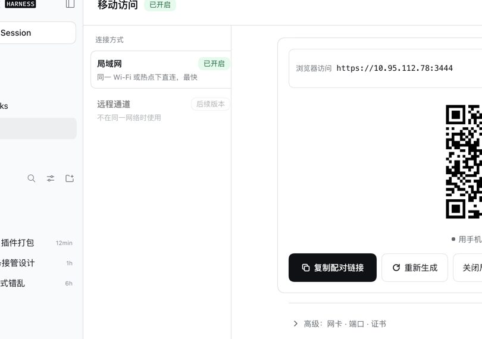

# dsh-mobile-next

Access your DeepSeek Harness from your phone. This is a **DSH host plugin** that
opens an authenticated HTTPS gateway on your computer, so a phone on the same
network can reach the real DSH page with a mobile layout.

It provides two independent channels:

- **LAN** — the phone reaches DSH over local HTTPS with device pairing. A
  private CA is generated per computer.
- **Remote (iroh, experimental)** — encrypted direct connection preferred,
  public relay as fallback. No domain or public port required. Needs the native
  sidecar on the host and an iroh-capable app. See [iroh setup](docs/remote-access.md).

> 中文说明见 [README.md](README.md)。

## Status

| Item | Status |
| --- | --- |
| Typecheck | ✅ `tsc --noEmit` clean |
| Tests | ✅ **147 passed, 2 skipped** (12 files) |
| Build | ✅ host 80 KB (gzip 23.1 KB) + client 75 KB (gzip 16.7 KB) |
| Loads in DSH | ✅ both host and client faces |
| UI | ✅ one-click full-screen panel from the sidebar |
| End to end | ✅ pairing → access DSH → security boundary |

## Install

```bash
# From the registry
dsh plugin --profile desktop add dsh-mobile-next@0.2.0

# Or from a tarball (offline / air-gapped)
pnpm pack
dsh plugin --profile desktop add ./dist/dsh-mobile-next-0.2.0.tgz
```

You can also use **Settings → Plugins → Install** in DSH and enter the package
name or a local path.

### Compatibility gate

`package.json` declares `engines.dsh: ">=0.2.2-rc.1 <0.3.0-0"`. A mismatched
DSH version is **rejected at install time** (`incompatible-version`) instead of
failing at runtime.

### Upgrading

```bash
dsh plugin add dsh-mobile-next@<newer-version>
```

Or click **Update** in the plugin page. Upgrading does **not** touch
`devices.json`, so paired phones do not need to pair again.

## Usage

The main entry point is a **sidebar icon** (`sidebar.panellist`). Clicking it
turns the center column into a full-screen panel. A fallback row is also
registered under `plugins.item`, in case the panel ever fails to open.

| Area | Contents |
| --- | --- |
| Header | Title + status badge; Diagnostics / Devices N / Close |
| Left rail | Channel list (LAN / iroh remote), each with independent enable and pairing |
| Main | Address + QR code + countdown + primary action, exhaustive by state |
| Drawer | Device list (revoke one / confirm revoke all), diagnostics |
| Advanced | Interface selection, listen port, CA fingerprint (copyable) |

The panel is **closed by default** (`initiallyEnabled: false`) and only listens
on loopback until you pick a network interface. Installing the plugin never
starts listening on its own.

### Panel state matrix

| Gateway | Badge | Primary action |
| --- | --- | --- |
| `stopped` | Off | Enable LAN access |
| `starting` | Starting | disabled (skeleton) |
| `running`, no code | On | Generate pairing QR |
| `running`, code present | On | Copy pairing link (+ countdown) |
| `running`, code expired | On | Regenerate QR |
| `error` | Error | Retry / diagnostics |
| No candidate interface | Not ready | Rescan |



## Security model

| Mechanism | Implementation |
| --- | --- |
| **Digest only** | `devices.json` holds `tokenDigest`; plaintext tokens never touch disk |
| **One-time pairing** | Pairing token valid 5 minutes, invalidated on use |
| **Rate limiting** | Per source IP, 10 attempts/minute by default |
| **Session cookie** | `HttpOnly` + `Secure` + `SameSite=Strict` |
| **Static allow-list** | `/assets/*` needs no auth (otherwise the login page cannot load) |
| **Admin route isolation** | Registered on loopback only; unreachable from the phone |
| **Secure by default** | `initiallyEnabled: false`; no listening until you enable it |

The gateway only proxies `/mobile-access-next/pair` and `/health`. **Every other
path under that prefix returns 404 and is never proxied** — otherwise a paired
phone could call `/pairing` to mint itself fresh tokens, or `/devices/revoke` to
kick other devices. This has a dedicated regression test.

## Privacy: where your data goes

**The plugin sends nothing to any third party.** No analytics, telemetry, crash
reporting, ads or remote config. The source contains exactly two `fetch()`
calls, both relative local paths (the panel calling itself, the pairing page
posting to itself). The pairing page is fully self-contained — no external
fonts, scripts or images.

The only persisted file is `devices.json`, with 6 fields per device:

```
deviceId, tokenDigest(SHA-256), label, createdAt, expiresAt, lastSeenAt
```

Device tokens are stored as **digests only**, so a disk leak is not a credential
leak. Session records live in memory and never touch disk. The gateway is a pure
reverse proxy — it does **not** record, cache or parse any conversation content
(all responses carry `cache-control: no-store`).

### ⚠️ Exception: the iroh remote channel uses a third-party relay

**This is the plugin's only third-party data path. You must know about it before
using the remote channel.**

The LAN channel involves no third party at all — data goes from your phone to
your computer inside your own Wi-Fi.

The **iroh remote channel uses n0's public infrastructure by default**
(`presets::N0`, see `native/iroh-host/src/main.rs`):

| Item | Exposed to a third party? |
| --- | --- |
| Conversation content, message bodies | **No** (QUIC end-to-end encrypted; TLS terminates on your computer) |
| Your public IP | **Yes** (required for the relay to establish a connection) |
| Endpoint ID | **Yes** (published to n0 DNS discovery) |
| Traffic volume, connection duration, timing | **Yes** (relay-visible metadata) |

When hole punching succeeds, traffic does not pass through the relay. Only when
it fails does traffic fall back to relaying (still encrypted).

**If that is not acceptable**, you have two options:

1. **Use the LAN channel only** and leave the remote channel off — no third
   party is involved at all.
2. Start with `--local-only`, which disables relay and DNS discovery and binds
   to loopback only (the phone cannot connect across networks; this is for
   local verification).

The remote channel is **off by default**, requires an explicit `start()` on every
process start, and its enabled state is never written to disk.

## Admin API

All routes live under `http://127.0.0.1:<dsh-port>/mobile-access-next/`
(**loopback only**):

| Method | Path | Purpose |
| --- | --- | --- |
| GET | `/status` | Gateway status + candidate interfaces + pairing window (no tokens) |
| GET | `/diagnostics` | Per-item self check (panel's Diagnostics drawer) |
| POST | `/network` | Select interface `{interfaceName}` |
| POST | `/enable` | Start/stop `{enabled}` |
| POST | `/pairing` | Mint a one-time pairing token, returns URL + inline SVG QR |
| GET | `/devices` | Paired devices |
| POST | `/devices/revoke` | Revoke `{deviceId}` |
| POST | `/devices/revoke-all` | Revoke all in a single server transaction |

> The prefix is **not** `/api/`. DSH applies its own browser auth layer to
> `/api/*`, returning 401 before the handler is reached.

## Pairing flow

1. On the computer, `POST /mobile-access-next/pairing` → receive `url`
2. The phone opens that URL (or scans the QR)
3. The phone `POST /pair {token}` → receives `deviceToken` + session cookie
4. The phone then sends the cookie; the gateway proxies to DSH

The phone's `sessionToken` is **not** DSH's `dsh-auth-*` cookie. The plugin holds
the upstream credential and injects it; the phone never sees DSH's secrets.

## Architecture

```
phone --HTTPS--> dsh-mobile-next gateway(:3444) --HTTP--> DSH(127.0.0.1:<port>)
                       ↓
              private CA signed cert + device session auth
```

| Layer | File | Responsibility |
| --- | --- | --- |
| Config | `config.ts` | Parse setup/control files; invalid values fall back, never throw |
| TLS | `tls.ts` | Private CA (10y) + server cert (397d, includes IP SAN) |
| Auth | `access.ts` | One-time pairing token, device token (digest only), sessions, rate limit |
| Gateway | `gateway.ts` | HTTPS reverse proxy + Host/Origin rewrite + WebSocket upgrade |
| Admin | `admin.ts` | Loopback admin routes (host machine only) |
| Network | `network.ts` | Interface discovery, private address detection, CIDR match |

The plugin **never modifies DSH source**. It inserts itself into the loader tree,
injects `webServer` and `connection`, and overrides layout slots.

## Development

```bash
cd dsh-mobile-next
pnpm install
pnpm run build        # rm -rf lib && tsdown (host + client)
pnpm run typecheck
pnpm test             # 149 items (incl. iroh controller / integration / native smoke)
node scripts/verify-client.mjs    # slot registration contract smoke
node scripts/verify-package.mjs   # tarball standalone install + dual-face load
node scripts/verify-patch.mjs     # cordis patch shape
```

The 2 skipped tests are the real-native smoke tests. They require a built
sidecar and skip explicitly when `DSH_IROH_HOST` is unset:

```bash
DSH_IROH_HOST=$REPO/native/target/release/dsh-mobile-iroh-host pnpm test
```

## Known limitations

| Limitation | Detail |
| --- | --- |
| iroh is experimental | Needs the native sidecar on the host and an iroh-capable app. Plain mobile browsers cannot use it. `running` only means the local sidecar is up — it does **not** prove the phone is reachable or whether the path is direct or relayed. See [iroh setup](docs/remote-access.md). |
| Remote channel uses a public relay | See [Privacy](#privacy-where-your-data-goes). |
| No `/mobile` command | In-conversation customization from the reference implementation is not implemented. |
| Pairing token in memory | Unused pairing codes are lost when DSH restarts; regenerate them. Device credentials are unaffected. |
| No `label` field means no render | Slot entries require a `label`. |

## License

MIT. See [LICENSE](LICENSE).

This package depends on `node-forge`, which is dual-licensed
`BSD-3-Clause OR GPL-2.0`. **This package uses it under the BSD-3-Clause
option**, which is compatible with MIT distribution. `qrcode` is MIT.
