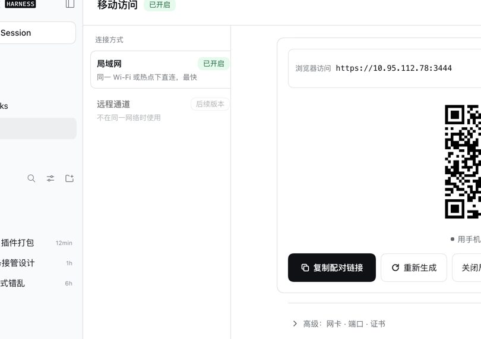
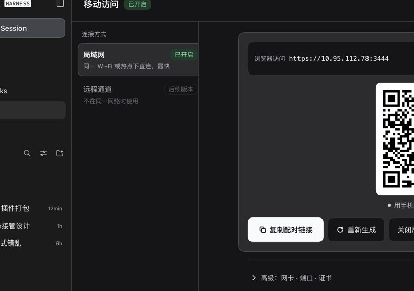
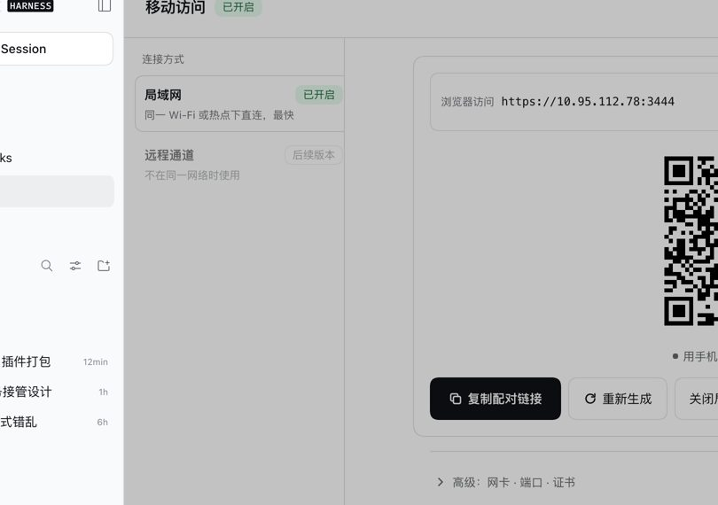

# dsh-mobile-next

DSH 移动端接入插件（自研）。提供两条互相独立的通道：

- **局域网**：手机通过局域网 HTTPS 访问电脑上的 DSH，带设备配对认证。
- **远程通道（iroh，实验性）**：加密直连优先、中继兜底，不需要域名或公网端口；需要本机原生组件与支持 iroh 的 App。见 [iroh 接入说明](docs/remote-access.md)。

## 状态

| 项 | 状态 |
| --- | --- |
| 类型检查 | ✅ `tsc --noEmit` 无错 |
| 测试 | ✅ **147 passed, 2 skipped**（12 个文件） |
| 构建 | ✅ host 45 KB + client 52 KB（gzip 11.8 KB） |
| 装进 DSH | ✅ 已加载（host + client 双面） |
| 界面 | ✅ 侧栏一键开全屏面板，真实页面验证过 |
| 端到端 | ✅ 配对 → 访问 DSH → 安全边界全通过 |

### 界面：侧栏一键直达的全屏面板



```
┌──────────────────────────────────────────────────────────┐
│ 移动访问  ● 已开启              [诊断] [设备 3] [✕]       │
├──────────────┬───────────────────────────────────────────┤
│ 局域网 已开启 │ 浏览器访问 https://192.168.1.5:3444 [⧉] │
│ 同一 Wi-Fi…  │                                           │
│              │              ┌──────────┐                 │
│ 远程通道     │              │  二维码   │                 │
│ iroh 已关闭  │              └──────────┘                 │
│              │  ● 用手机扫码配对 · 剩余 4:32              │
│              │  [复制配对链接] [重新生成] [关闭访问]       │
│              │  ▸ 高级：网卡 · 端口 · CA 指纹             │
└──────────────┴───────────────────────────────────────────┘
```

三个为「快速操作」做的设计决定：

1. **侧栏图标直达**（`sidebar.panellist`）—— 不再翻设置页找折叠行。
2. **开箱即出码** —— 面板打开时若网关已开启，**自动**生成二维码，
   少点一次。每个面板实例只自动生成一次，避免过期后无限重开。
3. **主操作随状态变** —— 没码时是「生成」，有码时是「复制链接」，
   用户永远只有一个"下一步点哪个"的答案。

面板状态矩阵（穷举，见 `src/client.tsx` 文件头）：

| 网关 | 徽标 | 主操作 |
| --- | --- | --- |
| `stopped` | 已关闭 | 开启局域网访问 |
| `starting` | 启动中 | disabled（骨架） |
| `running` 无码 | 已开启 | 生成配对二维码 |
| `running` 有码 | 已开启 | 复制配对链接（+ 倒计时） |
| `running` 码过期 | 已开启 | 重新生成配对二维码 |
| `error` | 出错 | 重试 / 诊断 |
| 无候选网卡 | 未就绪 | 重新扫描 |

### 分发：打包验证通过

本地开发用软链接（`node_modules/dsh-mobile-next` → 源码目录），
但**软链接不能分发给别人**。真实分发走 tarball：

```bash
pnpm pack                          # → dsh-mobile-next-0.2.0.tgz (~45 KB)
node scripts/verify-package.mjs    # 验证可独立安装并加载
```

验证内容：

```
包内文件       ✅ 10 个（lib/*.js + index.d.ts + locale + icon + patch + README）
入口解析       ✅ main / types / exports["."] / exports["./client"] / locale / icon
独立安装       ✅ 在干净项目里 pnpm add 成功
两面加载       ✅ host: inject=[webServer, connection]
                  client: loader id 正确，导出 apply + inject
```

**依赖分类已修正**：`@types/node-forge` 曾误放在 `dependencies`，
已移到 `devDependencies`（类型包不该进生产依赖）。

### 安装 / 升级（可独立发布）

三种方式，按场景选：

```bash
# ① tarball（离线分发、内网）
pnpm pack
dsh plugin --profile desktop add ./dist/dsh-mobile-next-0.2.0.tgz

# ② registry（团队共享）
pnpm publish --access public
dsh plugin --profile desktop add dsh-mobile-next@0.2.0

# ③ 插件页（GUI）
# 设置 → 插件 → 安装 → 填包名或本地路径
```

**实测过的完整链路**（干净 profile，`DSH_HOME=/tmp/dsh-home-test`）：

```
① 首次安装    dsh plugin --profile web add <tarball>
              → dependencies 记录 file: 路径
              → pnpm-lock.yaml 出现该包（6 处）
              → node_modules 是**实体目录**，不是软链
              → --dump-config 里出现 mobile-access-next 行

② 升级 0.2.0→0.2.1
              → "dsh-mobile-next 0.2.0 → 0.2.1"
              → 实体目录版本已更新

③ 降级 0.2.1→0.2.0（重跑 install-local）
              → 回到 0.2.0

④ 从零复现    rm -rf node_modules && pnpm install
              → 197 包装回，插件仍是 0.2.0（lock 可复现）
```

升级：`dsh plugin add dsh-mobile-next@<新版本>` 覆盖安装，
或插件页点「更新」。**升级不动 `devices.json`**，手机无需重新配对。

> 兼容性闸门：`package.json` 的 `engines.dsh` 是
> `>=0.2.2-rc.1 <0.3.0-0`。DSH 版本不匹配时安装会被拒
> （`incompatible-version`），而不是装完运行时报错。

#### 开发期的软链 → 真实安装

开发时 profile 里通常是软链（`node_modules/dsh-mobile-next` → 源码目录）。
它有两个后果：`dependencies` 与 `pnpm-lock.yaml` 里都没有它（不可复现），
插件页的「更新」按钮永远灰（DSH 要求"从 registry 以包名安装"）。

```bash
node scripts/install-local.mjs            # 软链 → 真实安装（tarball）
node scripts/install-local.mjs --revert   # 改回软链，继续开发
```

实测对比（同一个包）：

| 字段 | 软链 | 真实安装 |
| --- | --- | --- |
| `listBundles().installed` | `false` | **`true`** |
| `dependencies` 记录 | 无 | `file:…/dist/dsh-mobile-next-0.2.0.tgz` |
| `pnpm-lock.yaml` | 0 处 | 6 处 |
| `node_modules` | 软链 | 实体目录 |

⚠ tarball 必须落在**稳定目录**（仓库 `dist/`），不能放临时目录 ——
`pnpm add` 会把路径原样写进 `dependencies`，temp 目录被清理后
下次 `pnpm install` 直接失败（实测踩过）。

### 开发期热重载（不用重启 DSH）

```bash
pnpm build
node scripts/reload-plugin.mjs    # 禁用 → 启用，触发客户端模块重扫
node scripts/check-loaded.mjs     # 确认已进入 boot manifest
```

实测：`applied (changed=true)` 两次，面板立即生效。

### 客户端模块重载：不用重启 DSH

客户端模块清单（`dsh.client`）是 DSH 启动时扫描 Loader entries 构建的。
改了 `package.json` 后刷新页面没用。

**但不必重启整个应用** —— DSH 的 `pluginManager/setPluginEnabled`
描述里写着 "apply it on live profiles"，**禁用再启用即可触发重载**：

```bash
node scripts/reload-plugin.mjs   # 触发重载
node scripts/check-loaded.mjs    # 确认已加载
```

实测结果：

```
禁用…  applied (changed=true)
启用…  applied (changed=true)

boot manifest 模块数: 82（之前 81）
✅ 客户端模块已加载
   bundle URL: plugins/??dsh-mobile-next/client.js&rev=198ebeaa427c
```

bundle 实测可拉取：`HTTP 200`，10467 字节，含正确的 `__ModuleLoader__` 包装。

> **注意**：服务端清单已更新，但**已打开的浏览器页面需要刷新一次**
> 才会重新读 `window.__DSH_BOOT__`。

### 诊断脚本

`scripts/check-loaded.mjs` 能区分三种状态：

| 输出 | 含义 |
| --- | --- |
| ✅ 已加载 | 正常 |
| ❌ 未安装到 profile | 装错位置 |
| ❌ 清单在启动后修改 | 需要 `reload-plugin.mjs` |

### 客户端界面（已重写）

主入口是**侧栏图标**（`sidebar.panellist`），点一下中栏整块切成全屏面板；
插件页里还留了一行兜底入口（`plugins.item`），面板万一打不开时仍可达。

| 区域 | 内容 |
| --- | --- |
| 头部 | 标题 + 状态徽标；右侧「诊断」「设备 N」「关闭」 |
| 左栏 | 连接方式列表（局域网 / iroh 实验性远程通道，各自独立启停和配对） |
| 主区 | 地址 + 二维码 + 倒计时 + 主操作，按状态穷举切换 |
| 抽屉 | 设备列表（逐个撤销 / 二次确认全部撤销）、诊断（逐项自检） |
| 高级 | 网卡选择、监听端口、CA 指纹（可复制） |

实现要点：

- `src/client.tsx` 用 `__ModuleLoader__.load` 包装（构建时 banner 注入）
- React 与 `react/jsx-runtime` **都由 DSH loader 提供，不打包** ——
  `tsdown.config.ts` 的 `external` 必须同时列这两个，漏了 jsx-runtime
  会把 React 运行时内联一份进来（1.6 KB → 32 KB）
- 三个槽：`sidebar.panellist`（图标）、`main`（keyed 全屏面板，`key` 必填）、
  `plugins.item`（兜底行）
- 打开/关闭用 `ctx.get('layout').selectPanel(id | null)`；
  **`selectPanel` 对未注册 id 会 throw**，所以调用点包了 try/catch，
  面板没注册上时不会炸掉侧栏
- 样式只用 `--dsw-alias-*` / `--dsw-radius-*` / `--dsw-shadow-*` token，自动跟随主题

**为什么不 require `@deepseek-ai/dsh-client-ui-primitives`**：
DSH 的插件作者指南明确要求第三方插件不要依赖 Harness 的 Client 包 ——
它们会无预告变更，且组件一旦抛错整个 slot 条目会被摘除
（控制台 `slot entry crashed in '<slot>'`，界面直接空白）。
这里自写控件 + 只引用 token，宿主升级最坏是配色微调，不会白屏。

**`dsh.client.inject` 保持为空** —— 它装的是**包名**（模块图边，只影响预取顺序），
不是服务名。服务注入走模块导出的 `inject`（`export const inject = ['slots']`）。
两条轴，别混。

**`label` 是必需的** —— 缺了不渲染。

**参考实现里的槽名也已过时**（`dsh-client-ui-settings-general/lib/client.js`）：

```js
// 官方自己的用法，与我们的实现完全一致
ctx.slots.inject("settings.general.item", () => ctx.slots.register({
  name: "settings.general.item",
  id: "developer-tools",
  order: 15,
}, DeveloperToolsRow));
```

组件对 props 是**宽容的**：不依赖 DSH 传入的 `t`/`hooks`，
用不同 props 组合测试均能渲染（见 `scripts/verify-client.mjs`）。

验证（`scripts/verify-client.mjs`）：

```
manifest 校验   ✅ platform/inject/external 全合规
bundle 路径     ✅ 9985 字节，loader banner 正确
执行 client.js  ✅ 导出 apply + inject
调用 apply      ✅ effect → inject:settings.general.item → register
```

### 界面在真实 DSH 里验证过

用 headless Chrome + CDP 打开真实 DSH（注入浏览器会话 Cookie），
点侧栏图标，DOM 探针 + 截图确认：

```
侧栏行           ["Plugins","Plugin Market","Automation tasks","移动访问","More"]
点「移动访问」    → 中栏切成面板，data-global-panel 生效
二维码           自动生成，200×200 SVG
主操作           「复制配对链接」（有码时）
控制台错误        无
```

交互路径逐条跑过：

| 场景 | 结果 |
| --- | --- |
| 复制配对链接 | toast「配对链接已复制」+ 剪贴板内容与 host 返回一致 |
| 打开设备抽屉（空态） | 「还没有配对设备。生成二维码后用手机扫描即可。」 |
| 设备列表（3 台） | label + 最近连接时间 + 逐行撤销 |
| 全部撤销（二次确认） | 第一次点击变「确认撤销全部 3 台？」，第二次才执行 |
| 诊断抽屉 | 7 项，`role="dialog"` `aria-modal="true"` |
| Esc 关闭抽屉 | 关闭 |
| 焦点陷阱 | 首焦点在抽屉内，Tab 到末项回到首项，Shift+Tab 反向循环 |
| 关闭面板 | 回到会话（`data-global-panel` 变 null） |
| 再点侧栏图标 | 重新打开，二维码重新生成 |

暗色主题自动跟随（面板全部用 `--dsw-alias-*` token）：



诊断抽屉（拿不到的项显示「未检查」，不假装通过）：



### 可访问性（实算，不是估的）

用 DOM 探针逐元素算对比度（浅色 + 深色各跑一遍）：

```
浅色 4.84:1 ~ 20.94:1   深色 6.7:1 ~ 17.45:1   全部 ≥ WCAG AA 4.5:1
命中区 <44px：无（8 个可点元素，最小 44×44）
200% 字体缩放：无横向溢出（scrollWidth === clientWidth）
窄容器 760px：左栏自动收起，无横向溢出
```

两个必须知道的取舍：

- 宿主的 `--dsw-alias-label-caption` 当正文用只有 **2.13:1**（浅色），
  所以次级文字改用 `color-mix(caption 60%, label-primary)` → 4.84:1。
- 状态色直接当文字色也不够（green-500 on green-100 = **2.09:1**），
  同样压向 label-primary → 6.78:1，与宿主 `contextGreen` 的写法同源。

### 真机配对验证（Android 模拟器）

用 `flutter/tool/device_pair_probe.dart` 在真实 Android 环境跑完整链路
（走设备真实网络栈与证书处理，不是宿主机 Dart VM）：

```
设备: android sdk_gphone64_arm64-userdebug 16

--- 1. 不固定 CA（应失败）---
  ✅ 证书被拒（符合预期）
  HandshakeException: Handshake error in client

--- 2. 固定私有 CA ---
  health: HTTP 200

--- 3. 真实配对 ---
  CA 从 asset 读取: 1212 字符
  ✅ 配对成功
  deviceId: e42f343970aff98f4a6982d88e5aa269
  deviceToken 长度: 43
  sessionToken 长度: 43

--- 4. 用会话访问 DSH ---
  status: 200
  大小: 43065 字节
  含 DSH 标题: true
  含 __DSH_BOOT__: true
```

**第 1 步是负对照**：不固定 CA 时必须失败，否则说明 TLS 根本没在校验。

服务端确认设备已注册：

```json
{"devices":[{"label":"Android 真机","deviceId":"e42f3439…"}]}
```

### 真机验证结果

```
插件加载        ✅ ~/.dsh/mobile-access-next/ 已创建
管理 API        ✅ GET /mobile-access-next/status → 200
网卡发现        ✅ en0 / 192.168.1.5
网关启动        ✅ https://192.168.1.5:3444
未认证访问      ✅ 401（含中文提示）
配对            ✅ 201 + HttpOnly Secure Cookie
上游凭据交换    ✅ 拿到 dsh-auth-* Cookie（226 字节）
访问 DSH        ✅ 200，42876 字节，标题 "DeepSeek Harness"
安全边界        ✅ 伪造 Cookie 401 / 令牌复用 401 / 静态资源放行
Flutter 客户端  ✅ 固定私有 CA 后真实配对成功
二维码          ✅ 2883 字符 SVG，扫码 → GET 页 → 自动 POST 配对
```

### 客户端验证（真实 Flutter 代码）

```dart
// 固定插件的私有 CA（手机端必须做的事）
final caPem = File('.../tls/ca.pem').readAsStringSync();
final transport = IoHttpTransport(trustedCaPem: caPem);

final client = PairingClient(
  transport: transport,
  pairPath: '/mobile-access-next/pair',   // 本插件的端点
);
final result = await client.pair(descriptor, label: 'Flutter 客户端');
```

结果：

```
✅ 配对成功
   deviceId: 14c525f75939615b07bc76ec9b8390fc
   deviceToken 长度: 43
```

### 测试构成

| 文件 | 数量 | 验证内容 |
| --- | --- | --- |
| `network.test.ts` | 28 | 私有地址判定、CIDR、网卡发现、配置解析 |
| `access.test.ts` | 22 | 配对、限流、会话、持久化（只存摘要） |
| `gateway.test.ts` | 7 | **真实 HTTPS 握手** + 配对 + 代理 + Host 改写 |
| `plugin.test.ts` | 7 | 插件生命周期、管理路由、启停、dispose |
| `contract.test.ts` | 5 | 路由形态对齐真实 webserver 契约 |
| `e2e-router.test.ts` | 7 | **真实 HTTP 服务器**上的路由响应 |

## 架构

```
手机 --HTTPS--> dsh-mobile-next 网关(:3444) --HTTP--> DSH(127.0.0.1:<port>)
                      ↓
              私有 CA 签发证书 + 设备会话认证
```

四层：

| 层 | 文件 | 职责 |
| --- | --- | --- |
| 配置 | `config.ts` | 解析 setup/control 文件，非法值退默认不抛错 |
| TLS | `tls.ts` | 私有 CA（10 年）+ 服务器证书（397 天，含 IP SAN） |
| 鉴权 | `access.ts` | 一次性配对令牌、设备令牌（只存摘要）、会话、限流 |
| 网关 | `gateway.ts` | HTTPS 反代 + Host/Origin 改写 + WebSocket 升级 |
| 管理 | `admin.ts` | 回环管理路由（只在电脑本机能访问） |
| 网络 | `network.ts` | 网卡发现、私有地址判定、CIDR 匹配 |

## 安全设计

| 机制 | 说明 |
| --- | --- |
| **只存摘要** | `devices.json` 只有 `tokenDigest`，明文令牌绝不落盘 |
| **一次性配对** | 配对令牌 5 分钟有效，消费即失效 |
| **限流** | 按来源 IP，默认 10 次/分钟 |
| **会话 Cookie** | `HttpOnly` + `Secure` + `SameSite=Strict` |
| **静态资源放行** | `/assets/*` 等无需认证（否则登录页打不开） |
| **管理路由隔离** | 只在回环注册，手机访问不到 |
| **默认关闭** | `initiallyEnabled: false`，装完不自动对外监听 |

## 八个真实的实现陷阱（值得记录）

### 陷阱一：默认导出缺失

首次加载报 `plugin is undefined` —— `src/index.ts` 只导出了**具名** `plugin`，
而 DSH loader 可能按默认导出取插件函数。

修复：同时提供 `export default` 与具名导出，兼容两种约定。

### 陷阱二：`register` 的形态是 `kind` 不是 `method`

`ctx.webServer.register(route)` 的契约来自
`@deepseek-ai/dsh-host-webserver` 的 `WebRoute`：

```js
register(route) {
  const table = route.kind === "exact" ? this.exact : this.prefixes;
  // ...
}
```

我最初写成 `{ method: 'GET', path, handler }`。后果是**静默失败**：

- `route.kind` 是 `undefined` → 落进 `prefixes` 表
- 精确路径**永远匹配不到** → 请求 404
- 注册本身不报错，看起来"成功"了

**这个坑只有真正发请求才会暴露。** 修复后加了 `contract.test.ts`
逐行复刻真实 `register` 语义，防止再被改坏。

### 陷阱三：管理路由不能放在 `/api/` 下

DSH 对 `/api/*` 有**自己的认证层**（浏览器会话 Cookie），未认证返回
`401 unauthorized`，**在到达我的 handler 之前就被拦掉**。

实测现象很迷惑：
- `status` / `devices` / `pairing` 能用
- 新加的 `probe-upstream` 一直 401
- 一度以为是路由注册失败，查了很久

原因：这些端点碰巧走了不同分支，而新端点直接撞上 DSH 的 `/api` 认证。
改用 `/mobile-access-next/` 前缀（与参考实现一致）后立刻通了。

### 陷阱四：DSH 自己也要求认证

**这是整个插件最容易漏的一环。**

DSH 的 Web 页面用 `dsh-auth-*` 签名 Cookie 校验，密钥在
`$DSH_HOME/.credentials.yaml`。所以只做设备认证是不够的：

```
手机 --[我的Cookie]--> 网关 --[无 Cookie]--> DSH
                                              ↓
                                  "dsh web authentication required"
```

**最迷惑的地方**：看到 401 时，第一反应是"我的会话校验失败了"，
但实际是 DSH 上游在拒绝。两者文案不同：

| 来源 | 文案 |
| --- | --- |
| 本插件 | `dsh-mobile-next: authentication required.` |
| DSH | `dsh web authentication required; reopen the URL printed by dsh web.` |

**正确做法**（照参考实现）：用 `ctx.connection.authenticatedUrl(origin)`
拿带 launch token 的 URL → GET 它 → DSH 返回 `303` + `Set-Cookie: dsh-auth-*`
→ 注入每个代理请求。

见 `src/upstream-auth.ts`。

### 陷阱五：客户端必须固定私有 CA

用 Flutter 的默认 `HttpClient` 连网关时报：

```
HandshakeException: CERTIFICATE_VERIFY_FAILED
```

原因：私有 CA 不在系统信任链里。这不是缺陷，是**自签方案的必然结果**。

**修复**：`IoHttpTransport` 加 `trustedCaPem` 参数，用 `SecurityContext`
只信任该 CA（`withTrustedRoots: false`，不叠加系统根）。

⚠ **绝不能用 `badCertificateCallback = (_,_,_) => true`** ——
那等于没有 TLS，中间人可以随意劫持。

### 陷阱六：配对响应要同时给 Cookie 和 body token

浏览器路径靠 `Set-Cookie`，原生客户端靠 body 里的 `sessionToken`（存 Keystore）。

只给 Cookie 时，Flutter 客户端报 `pairing response missing "sessionToken"`。
参考实现 `dsh-mobile` 两者都给，这里照做。

### 陷阱七：二维码指向 POST 端点会 405

二维码内容只能是一个 URL，**扫码必然是 GET 请求**。

我最初让 `pairingUrl` 指向 `/mobile-access-next/pair` —— 那是 POST 端点。
扫码得到 **405**。

**修复**：加一个 GET 页面（`#handlePairPage`），渲染 HTML 并自动提交 POST。
现在扫码流程是：

```
扫码 → GET /pair?token=…（HTML 页）→ 页面 JS 自动 POST → 201 → 「进入 DSH」
```

页面上有中文提示与「进入 DSH」按钮，并区分了「配对码无效/已过期」。

### 陷阱八：证书链

服务器证书最初用 `selfsigned.generate()`，测试报 `self-signed certificate`。

查源码发现：

```js
cert.sign(keyPair.privateKey, ...)   // 永远用自己的私钥签 = 自签
```

`selfsigned` **不支持用现有 CA 签发**，只会生成自签证书。

改用 `node-forge` 手动构造 + `cert.sign(caPrivateKey)` 后，又踩了两个：

| 错误 | 原因 | 修复 |
| --- | --- | --- |
| `unable to verify the first certificate` | 只给叶子证书，客户端不知签发者 | 客户端传 `ca:` 显式信任 |
| `self-signed certificate in certificate chain` | 把自签 CA 也塞进链里 | 服务器只发叶子，CA 单独提供 |

**这个坑只有客户端真正校验证书链时才暴露**。如果测试里 `rejectUnauthorized: false`，永远发现不了。

## 管理 API

全部在 `http://127.0.0.1:<dsh-port>/mobile-access-next/` 下（**回环专用**）：

| 方法 | 路径 | 作用 |
| --- | --- | --- |
| GET | `/status` | 网关状态 + 候选网卡 + 配对窗口（不含令牌） |
| GET | `/diagnostics` | 逐项自检（面板「诊断」抽屉） |
| POST | `/network` | 选定网卡 `{interfaceName}` |
| POST | `/enable` | 启停 `{enabled}` |
| POST | `/pairing` | 生成一次性配对令牌，返回 URL + 内联 SVG 二维码 |
| GET | `/devices` | 已配对设备 |
| POST | `/devices/revoke` | 撤销 `{deviceId}` |
| POST | `/devices/revoke-all` | 一次撤销全部（服务端单事务） |

> ⚠ **路径前缀不是 `/api/`**。DSH 对 `/api/*` 有自己的浏览器认证层，
> 未认证会在到达 handler 前返回 401。实测踩过，见下文「陷阱三」。

> ⚠ **网关不会透传这些路径**。`/mobile-access-next/*` 下除 `/pair` 与 `/health`
> 之外一律 404（`gateway.ts`）。否则一台已配对的手机就能
> `POST /pairing` 给自己续期、`POST /devices/revoke` 踢掉其他设备。
> 这条有专门的回归测试（`tests/gateway.test.ts` → 「管理路径不得经网关透传」）。

## 配对流程

1. 电脑本机 `POST /api/mobile-access-next/pairing` → 拿到 `url`
2. 手机打开该 URL（或扫码）
3. 手机 `POST /pair {token}` → 拿到 `deviceToken` + 会话 Cookie
4. 之后手机带 Cookie 访问，网关代理到 DSH

## 从源码开发

```bash
cd dsh-mobile-next
pnpm install
pnpm run build        # rm -rf lib && tsdown（host + client 双面）
pnpm run typecheck
pnpm test             # 149 项（含 iroh controller / 集成 / 真实 native 冒烟）
# 真实 native 冒烟需要已构建的组件（否则该 2 项显式 skip）：
# DSH_IROH_HOST=$REPO/native/target/release/dsh-mobile-iroh-host pnpm test
node scripts/verify-client.mjs    # 槽注册契约冒烟
node scripts/verify-package.mjs   # tarball 独立安装 + 双面加载
node scripts/verify-patch.mjs     # cordis patch 形态
```

⚠ `tsdown` 的两个配置是**并行**执行的，所以 `clean` 只能在 build 脚本里做一次
（`rm -rf lib`）。曾把 `clean: true` 放在 host 配置里，结果 host 的 clean
在 client 写完之后把 `lib/client.js` 删掉了 —— tarball 少了 client 面，
插件装上了但面板不出现。

## 已知限制

| 限制 | 说明 |
| --- | --- |
| iroh 为实验性原生通道 | 远程通道已接入 iroh；需要配置本机原生组件并使用支持 iroh 的 App，不支持普通手机浏览器。详见 [iroh 接入说明](docs/remote-access.md)。不使用 Cloudflare。 |
| 无 `/mobile` 命令 | 参考实现的对话内定制没做 |
| 手机端 App 未接新端点 | `flutter/` 侧的 UI 重设计是另一个交付面，本轮只改了电脑端插件 |
| 配对令牌在内存里 | DSH 重启后未用完的配对码失效，需要重新生成（设备凭据不受影响） |

### 陷阱九：网关会把管理路径透传给手机（安全边界）

**这是本轮修掉的一个真实漏洞。**

`admin.ts` 的注释原本写着"这些路由只在回环注册，手机看不到也调不到"。
这句话**不成立**：`gateway.ts` 的请求门只处理 `/pair` 与 `/health`，
其余 `/mobile-access-next/*` 全部落到"校验会话后透传给 DSH"——
而管理路由正注册在 DSH 那边。

后果：任何**已配对**的手机可以

```
POST /mobile-access-next/pairing          → 给自己签发新令牌（无限自我续期）
POST /mobile-access-next/devices/revoke   → 踢掉其他设备
```

修法是在网关里显式 404：

```ts
if (pathname.startsWith(`${AUTH_PREFIX}/`)) {
  sendJson(response, 404, { error: 'not_found' })
  return
}
```

顺带的好处：漏注册的新端点会立刻 404 暴露，而不是变成"接口写好了但一直 404"
这种需要排查的谜。

回归测试在 `tests/gateway.test.ts`：对 7 条管理路径各发两次请求
（带合法 Cookie / 不带），全部断言 404，并断言设备数没有增加。

### 陷阱十：`tsdown` 的两个配置并行，`clean` 会互相打架

`defineConfig([hostConfig, clientConfig])` 是**并行**执行的。
把 `clean: true` 放在 host 配置里，host 的 clean 可能在 client 写完之后
把 `lib/client.js` 删掉。

症状：`pnpm pack` 出的 tarball 少了 `client.js`，插件装上了但**面板不出现**，
控制台也没有明显报错（client 模块根本不在清单里）。

修法：两个配置都 `clean: false`，清目录交给 build 脚本（`rm -rf lib && tsdown`）。

### 陷阱十一：JSX 的 `react/jsx-runtime` 必须单独 external

`external: ['react']` **不够**。rolldown 会把 `react/jsx-runtime` 整个内联进来：

```
external: ['react']                     → client.js 31.9 KB（内联了 jsx-runtime）
external: ['react', 'react/jsx-runtime'] → client.js  1.6 KB（只留 require）
```

内联意味着插件里多出一份独立的 React 运行时，hooks 与宿主不同源 ——
面板状态可能不更新，且难以排查。`package.json` 的 `dsh.client.external`
只在"不在种子表里"时才需要写；`react` 与 `react/jsx-runtime` 都在种子表里。

### 陷阱十二：`label-caption` 与状态色不能直接当正文色

宿主 token 是给"装饰性"信息用的，拿来写正文不达标（实测）：

| token | 用作文字时的对比度 | 处理 |
| --- | --- | --- |
| `--dsw-alias-label-caption` (#adb2b8) on white | **2.13:1** | `color-mix(caption 60%, label-primary)` → 4.84:1 |
| `state-success-primary` (#22c55e) on `success-tertiary` | **2.09:1** | `color-mix(success 45%, label-primary)` → 6.78:1 |
| `state-warn-primary` (#f59e0b) on `warn-tertiary` | **1.99:1** | 同上 → 6.61:1 |

深色主题下这些 color-mix 结果分别是 8.79 / 7.91 / 10.92，也达标。
这与宿主自己 `contextGreen` 用的 `color-mix(... 68%, label-secondary)` 是同一种思路。

### 陷阱十三：软链安装让「更新」永远灰，且不可复现

`listBundles()` 对软链安装返回 `installed: false` —— DSH 的 `updateRefusal`
要求插件「从 registry 以自身包名安装」，`file:` / 软链 / git 都不满足。
所以插件页的「更新」按钮永远是灰的，只能手工重装。

更隐蔽的后果是**不可复现**：profile 的 `dependencies` 与 `pnpm-lock.yaml`
里都没有它，换台机器 clone 下来装不出一样的环境。

用 `node scripts/install-local.mjs` 换成真实安装即可（`installed` 变 `true`）。

### 陷阱十四：`pnpm add <tarball>` 会把临时路径写进 dependencies

`pnpm add /tmp/xxx/dsh-mobile-next-0.2.0.tgz` 之后，profile 的
`dependencies` 里是 `file:/tmp/xxx/dsh-mobile-next-0.2.0.tgz`。
如果 tarball 在 `mkdtemp` 目录里、脚本结束时被删掉，**下次 `pnpm install` 直接失败**。

实测踩过：第一版 `install-local.mjs` 用 `mkdtempSync` 打包，`finally` 里清理，
结果 profile 的 `dependencies` 指向了一个已经不存在的文件。

修法：tarball 落在仓库的 `dist/`（稳定路径），脚本不删它。

### 陷阱十五：仓库内 `pnpm pack` 会跑 prepack，可能清掉 node_modules

`pnpm pack` 会执行 `prepack` 脚本。如果 `prepack` 里有 `pnpm run build`
而 `build` 是 `rm -rf lib && tsdown`，在某些状态下（依赖目录不完整）
会连 `node_modules` 一起丢掉，后续 `tsdown: command not found`。

现在 `prepack` 只做 `pnpm run build`，重活（typecheck + test + verify-package）
放在 `prepublishOnly`，只在真正 `npm publish` 时跑。

`install-local.mjs` 还额外做了两件事：

- 打包前检查仓库 `node_modules/tsdown` 在不在，缺了先 `pnpm install`；
- `pnpm pack --config.ignore-scripts=true` 跳过 prepack（上面已经显式 build 过）。

### 陷阱十六：仓库 `node_modules` 缺失会让 host 面整个挂掉

这个坑最隐蔽，因为**症状与原因完全不像**。

软链安装时，插件代码从**仓库目录**解析依赖，所以 `require('qrcode')`
走的是仓库的 `node_modules`。如果仓库 `node_modules` 被删（例如打包流程
把它清掉了），loader 报：

```
failed to import: Error [ERR_MODULE_NOT_FOUND]:
Cannot find package 'qrcode' imported from /Users/…/dsh-mobile-next/lib/index.js
```

后果不是"面板不显示"，而是：

- `listPlugins()` 里该条目 `fiberPhase: null`（没挂载）
- **host 面的管理端点全部 404**（`/mobile-access-next/status` 直接 404）
- 客户端模块也不进 boot manifest

排查顺序建议：先看 `/mobile-access-next/status` 是否 200，再看
`pluginManager/listPlugins` 的 `fiberPhase`，最后看 loader 日志里的 import 错误。
别一上来就怀疑网关或证书。
